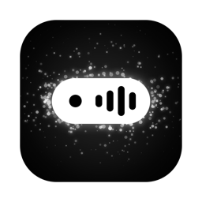
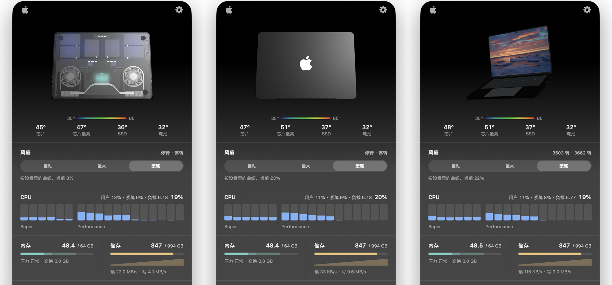
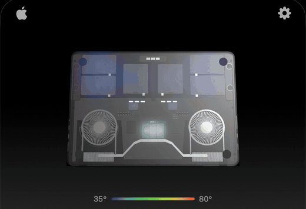
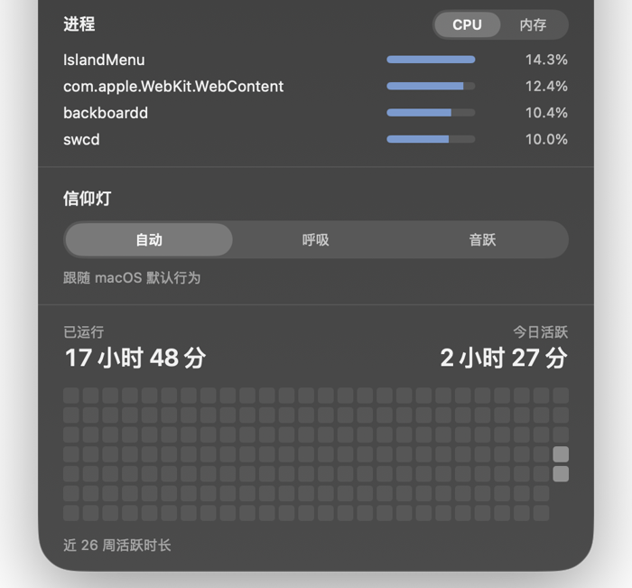
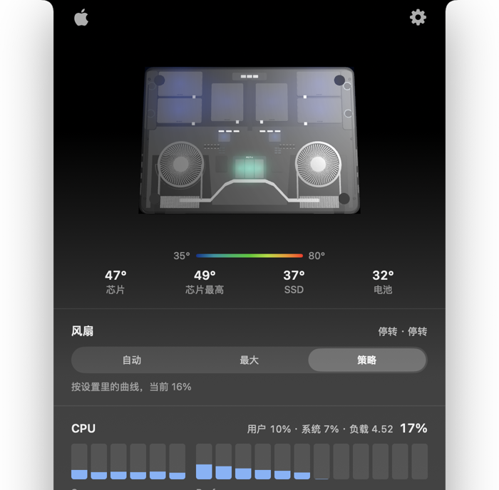

<p align="center"></p>

# Island Menu

常驻后台的 macOS 性能监控。点击 MacBook 的灵动岛或刘海，会从那里展开一张卡片，显示 CPU、内存、GPU、储存、电池、网络、进程和温度。



机模平时是静帧，单击翻面，双击开合屏幕：



| 卡片下半部分 | 刘海机型的版式 |
|---|---|
|  |  |

目前只在 14 寸 M5 Pro（Mac17,13，macOS 27.3）上实际运行过。刘海版式、另外四款机模和无风扇机型的界面都是在这台机器上模拟验证的，
还没有在真正的刘海机型或 macOS 27.2 上运行过；在那些机器上遇到问题欢迎提 issue。

## 功能

### 面板

点击灵动岛（或刘海、菜单栏图标）展开，点面板外或按 Esc 收起。单列滚动，从上到下：

| 栏目 | 内容 |
|---|---|
| 机模 | 本机的 3D 模型，见下一节 |
| 温度 | 芯片平均、芯片最高、SSD、电池 |
| 风扇 | 两个风扇的转速，自动 / 最大 / 策略三种模式 |
| CPU | 总占用、用户 / 系统、负载，Super 与 Performance 两组核心的每核占用 |
| 内存 | 已用 / 总量、内存压力、交换 |
| 储存 | 已用 / 总量、读写速率、用量趋势 |
| GPU | 占用及其走势、显存占比与用量、温度 |
| 电池 | 电量、循环次数、健康度、适配器功率；电源输入、整机功耗、电池充放电功率；自动 / 养护 / 满充 |
| 网络 | 上下行速率、各接口及其地址和协商速率、公共 IP（可关） |
| 进程 | 按 CPU 或内存排序的进程排行 |
| 信仰灯 | 顶盖 logo 灯的三种模式 |
| 活跃时长 | 已运行时间、今日活跃时长、近 26 周的活跃热力图 |

没有风扇或没有 logo 灯的机型不显示对应栏目。配色有「彩色」（每个栏目一种低饱和度的颜色）和「纯白」两种。

### 3D 机模

- **五款机身**：14 寸 PROLED MacBook Pro、刘海款 MacBook Pro 14 / 16 寸、MacBook Air 13 / 15 寸，按本机硬件自动选择，尺寸取自 Apple 官方规格。
- **两面**：展开面板时随机显示顶盖或底面。平时是静帧，不持续渲染。
  - 顶盖：机身颜色、logo、你贴的贴纸。
  - 底面：底壳透明，能看到电芯、主板、芯片、风扇和热管；上面叠一层羽化的温度热力图（35°–80°，蓝 → 绿 → 黄 → 红），风扇按实际转速转动，外圈颜色随转速变化，并有进出风的气流粒子。
- **操作**：单击翻面，双击把屏幕打开到 108°，再点一下合上。
- **机身颜色**：设置 →「机模」，按 Pro 系列（深空黑、深空灰、银色）、Air 系列（午夜色、星光色、天蓝色、银色）、Neo 系列（Blush、Citrus、Indigo、银色）任选，不受机型限制。
- **屏幕内容**：打开屏幕时可以显示当前壁纸（含航拍动态壁纸的画面）或自己上传的图片，也可以保持熄屏。
- **贴纸**：设置 →「贴纸」，从照片或文件选一张图，用系统的主体提取（和「照片」里长按抠图是同一个功能）抠出主体，拖到顶盖上摆放，可调大小、旋转。十种效果：原图、描边、漫画、立体、闪亮、黑白、鎏金、线稿、像素、霓虹。

### 风扇控制

- **自动**：交给 macOS。
- **最大**：两个风扇全速。
- **策略**：按你在设置里画的温度曲线控制转速。曲线为 0 的温度段交还给 macOS；芯片到 95 °C 时无论曲线如何都全速。

写入转速需要 root 权限，由一个随 App 安装的后台组件完成：首次使用时在面板的风扇栏点安装，然后在「系统设置 → 通用 → 登录项与扩展」里批准。App 退出或崩溃后，这个组件会在 15 秒内把风扇交还系统。

### 电池养护

使用 macOS 自带的充电上限，不需要额外权限，App 退出后依然有效。

- **自动**：不设上限。
- **养护**：充到设定的上限就停，可选 80 / 85 / 90 / 95%，默认 85%。
- **满充**：这一次充到 100%，之后回到上限。

### 信仰灯（PROLED 机型）

顶盖 logo 灯的三种模式：**自动**（跟随 macOS）、**呼吸**（4.5 秒一次，由硬件完成渐变）、**音跃**（随系统正在播放的声音律动）。

### 防休眠

点面板左上角的苹果标开启，再点一次关闭：

- 开启后 Mac 不会进入睡眠，屏幕调到你设定的亮度（设置 →「通用」→ 防休眠，默认 20%），适合挂着下载、跑任务时用。
- 关闭或退出 App 时恢复原来的亮度。
- 开启期间苹果标变成彩色；机模上的 logo 在有信仰灯的机型上像夜店灯一样跳色闪烁，在其他机型上是一道扫过镜面 logo 的高光。

### 提醒

平时灵动岛上什么都不显示。下面任一项越过阈值时，系统灵动岛右侧出现一个提醒，恢复后自动消失；点开有一行说明和「展开面板」按钮。每项都可以在设置 →「提醒」里单独开关和调阈值。

| 提醒 | 默认阈值 |
|---|---|
| 温度过高 | 95° |
| 电量不足 | 低于 20% 且未接电源 |
| 储存空间不足 | 95% |
| CPU 占用过高 | 90% |
| GPU 占用过高 | 90% |

提醒用的是 macOS 27.3 的实时活动，更早的系统上没有这项功能。

### 隔空投送

拖着文件靠近屏幕顶部时，灵动岛下方出现一个投放区，松手即打开系统的隔空投送。

### 灵动岛与刘海

- **灵动岛机型**：面板是一张悬浮的圆角卡片，从药丸位置展开。点击灵动岛时系统自己的卡片也会弹出；在「系统设置 → 隐私与安全性 → 辅助功能」里给 Island Menu 授权后，点击只打开 Island Menu。
- **刘海机型**：面板从刘海里长出来，顶边与屏幕边框连成一体。
- 版式自动判断，也可以在设置 →「通用」→ 屏幕形态里手动选择。

### 设置

菜单栏图标 →「设置…」，或面板右上角的齿轮。

| 页 | 内容 |
|---|---|
| 通用 | 图表配色、屏幕形态、登录时启动、防休眠亮度、是否显示公共 IP |
| 机模 | 机身颜色、开盖时的屏幕内容 |
| 贴纸 | 制作和摆放贴纸 |
| 提醒 | 五项提醒的开关和阈值 |
| 风扇 | 风扇策略曲线 |
| 电池 | 充电上限 |

## 资源占用

在 14 寸 M5 Pro 上测得，风扇策略模式开启：

| 状态 | CPU | 内存 |
|---|---|---|
| 启动后未展开 | 约 0.1–0.2% | 约 20 MB |
| 展开过再收起 | 约 0.2% | 约 60 MB |
| 展开中 | 约 3–6% | 约 180 MB |

收起时不采集面板数据，只保留提醒检测（每 5 秒）、风扇控制循环（开启时每 3 秒）和每分钟一次的活跃时长记录；面板内容和 3D 模型在收起后全部释放。

## 安装

从 [Releases](https://github.com/YYshen07/Island-menu/releases) 下载压缩包，解压后把 `Island Menu.app` 拖进「应用程序」再打开。安装包由 Developer ID 签名并经过 Apple 公证。

需要 Apple 芯片的 MacBook 和 macOS 27.0 或更新版本。风扇控制必须从 `/Applications` 运行。

## 构建

构建需要 Xcode 27.3（测试版期间装在 `/Applications/Xcode-beta.app`）和 [XcodeGen](https://github.com/yonaskolb/XcodeGen)。

构建出的 App 最低可在 macOS 27.0 上启动；灵动岛提醒依赖 macOS 27.3 的实时活动，更早的系统上没有提醒，其余功能不变。

```sh
./scripts/bundle.sh                 # 生成 build/Island Menu.app
open "build/Island Menu.app"
./scripts/install.sh                # 构建并安装到 /Applications（风扇控制需要从这里运行）
./scripts/package.sh                # 生成 build/IslandMenu-<version>.zip
```

钥匙串里有 Developer ID Application 证书时，`bundle.sh` 会用它签名，否则用临时签名。`package.sh` 在找到名为 `islandmenu-notary` 的 notarytool 钥匙串凭据时会提交公证并装订票据；没有公证的包首次打开会被 Gatekeeper 拦截，需要在「系统设置 → 隐私与安全性」里放行。

风扇控制组件只接受由同一开发者团队签名的 Island Menu 的连接。用自己的证书构建时，需要把 `Sources/IslandShared/FanHelperProtocol.swift` 里的 `teamIdentifier` 改成你的团队 ID。

## 隐私

- 「音跃」模式会读取系统正在播放的声音的响度，需要「系统音频录制」权限；只计算响度，不录制、不保存。
- 贴纸和上传的屏幕图片只保存在本机 `~/Library/Application Support/IslandMenu/`，抠图由系统在本机完成。
- 公共 IP 通过 `api.ipify.org` 查询，只在卡片展开时触发，最多每 10 分钟一次。
- 活跃时长和储存用量历史保存在本机 `~/Library/Application Support/IslandMenu/history.json`，不上传。

## 目录

- `Sources/IslandMenu/` — App 源码
- `mockup/` — 网页设计稿（数据为模拟）
- `docs/3d-model-brief.md`、`docs/3d-model-brief-lineup.md` — 3D 机模制作说明（现有机型、刘海机型全系）
- `docs/images/` — 本页的截图，由 `scripts/screenshots.sh` 生成
- `assets/icon/` — App 图标，由 `scripts/make_icns.sh` 生成
- `assets/model/` — 3D 机模（Blender 源文件与导出的 USDZ / GLB）

## 许可

源码公开，仅限非商业使用，见 [LICENSE.md](LICENSE.md)（PolyForm Noncommercial 1.0.0）。可以自行构建、修改和自用，不可用于商业目的。

## 致谢

实现时参考了这些 MIT 许可的项目：
[logoctl](https://github.com/XZCendence/logoctl)、
[LogoLight](https://github.com/Ark0N/LogoLight)、
[DynamicNotchKit](https://github.com/MrKai77/DynamicNotchKit)、
[stats](https://github.com/exelban/stats)、
[macmon](https://github.com/vladkens/macmon)。
